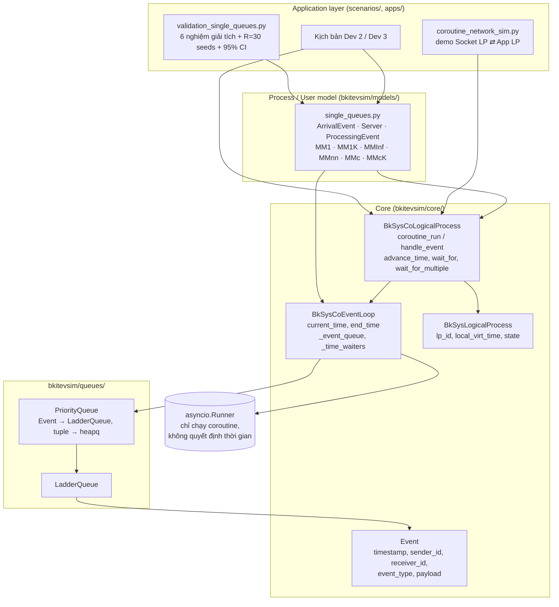
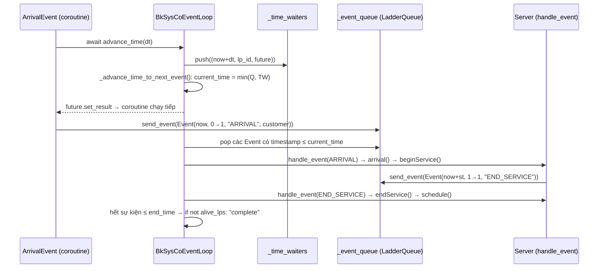
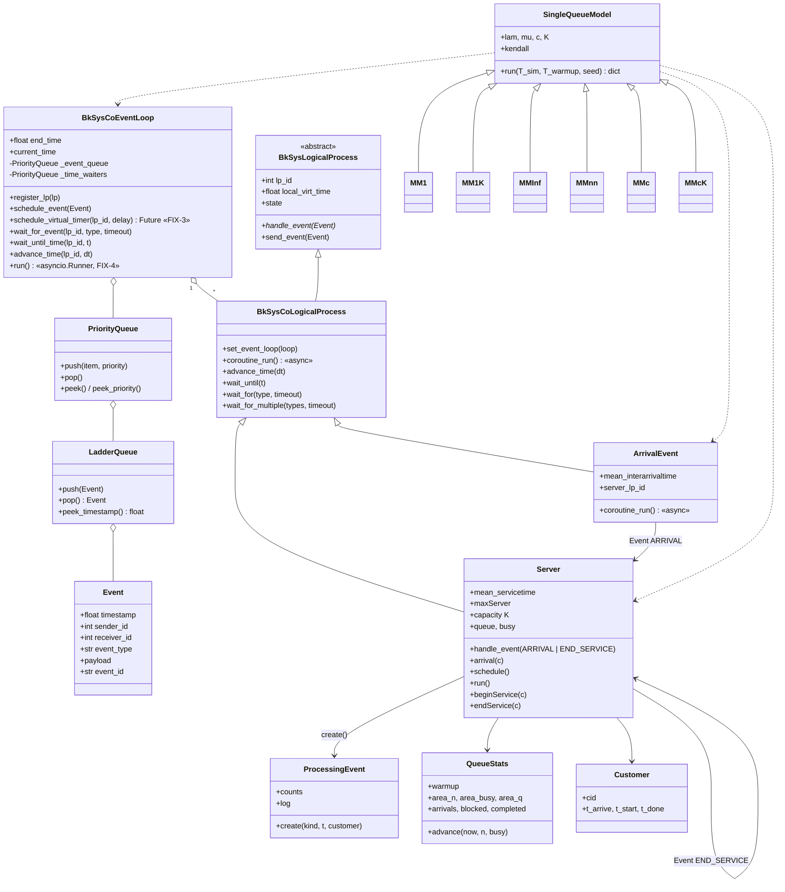

# bkitevsim – Kiến trúc, Sơ đồ lớp & Validation 6 hàng đợi đơn

Nhóm XX-004679A · CO3007 · Dev 1 (Lõi DES + 6 hàng đợi đơn + Validation)

> Mã nguồn nền: framework gốc của môn học **BKsyspeEvsim** (`hk261_spe_BKsyspeEvsim`). Dev 1 chỉ sửa
> `bkitevsim/core/logical_coProcess.py`, `scenarios/coroutine_network_sim.py` và tạo mới
> `bkitevsim/models/single_queues.py`, `scenarios/validation_single_queues.py`. Mọi file khác giữ nguyên bản gốc.
>
> Quy ước: mọi đại lượng trong mô phỏng dùng SI (giây `s`, `req/s`). Chỉ khi xuất bảng mới đổi sang `ms`.
> Không dùng `time.sleep`, `asyncio.sleep(d>0)`, hay `asyncio.wait_for/wait(timeout=...)` theo đồng hồ thực.
> Mọi trễ/timeout đều chạy theo Virtual Time của `BkSysCoEventLoop` (`LadderQueue` + `_time_waiters`).

## 1. Kiến trúc tổng thể



**Cách Virtual Time vận hành** – vòng lặp `BkSysCoEventLoop._run_async()`:

1. Tạo task cho `coroutine_run()` của mọi LP đã `register_lp()`; nhường lượt để các LP lên lịch sự kiện đầu tiên.
2. `_process_events_at_current_time()`: lấy mọi `Event` có `timestamp ≤ current_time` khỏi `_event_queue`,
   đặt `local_virt_time` của LP nhận = `timestamp`, gọi `handle_event(event)`, rồi đánh thức các LP đang
   `wait_for(event_type)`.
3. Nếu còn LP ở trạng thái `READY` thì nhường lượt (`asyncio.sleep(0)`) cho chúng chạy tới lần `await` kế tiếp.
4. Khi không còn sự kiện tại thời điểm hiện tại và không còn LP `READY`: `_advance_time_to_next_event()` nhảy
   `current_time` tới min(sự kiện kế tiếp, timer kế tiếp trong `_time_waiters`), giải phóng các timer đến hạn
   (`advance_time`, `wait_until`, timeout ảo).
5. Không còn gì ≤ `end_time` → dừng: `if not alive_lps` → "simulation complete", ngược lại cảnh báo các LP bị kẹt.



## 2. Sơ đồ lớp



Ánh xạ 6 mô hình vào `Server(maxServer, capacity)` (LP id: `ArrivalEvent` = 0, `Server` = 1):

| Kendall | Class | `maxServer` | `capacity` (K) |
|---|---|---|---|
| M/M/1 | `MM1` | 1 | ∞ |
| M/M/1/K | `MM1K` | 1 | K |
| M/M/∞ | `MMInf` | ∞ | ∞ |
| M/M/n/n (Erlang-B) | `MMnn` | n | n |
| M/M/c (Erlang-C) | `MMc` | c | ∞ |
| M/M/c/K | `MMcK` | c | K |

Ghi chú khi dùng framework gốc:

- `BkSysCoEventLoop._process_events_at_current_time()` bắt mọi exception của `handle_event` và chỉ ghi log.
  `Server` vì vậy giữ lại lỗi đầu tiên và `SingleQueueModel.run()` ném lại, để lỗi không bị nuốt âm thầm.
- `LadderQueue` gốc tính bucket bằng `int(t / bucket_width) % 1024`: sự kiện có `t ≥ 1024·bucket_width` bị
  "quấn vòng" và lấy ra sai thứ tự. Mô hình đặt `bucket_width = T_sim / 256`, để cả horizon chỉ dùng 1/4 vòng.
  Dev 2/Dev 3 tự tạo `BkSysCoEventLoop` cần chọn `bucket_width` tương tự (mặc định 1.0 chỉ an toàn tới t < 1024 s).

## 3. Các bản vá lõi

| # | Vị trí | Lỗi trong mã gốc | Cách xử lý |
|---|---|---|---|
| 1 | `logical_coProcess.py` `wait_for_event` | Ném `EVENT_TIMEOUT_ERROR` chưa định nghĩa (→ `NameError`) | `raise TIMEOUT_ERROR(...)` (= `asyncio.TimeoutError`) |
| 2 | `logical_coProcess.py` `_run_async` | `if alive_lps:` báo "All LPs terminated" ngược logic | `if not alive_lps:` → log hoàn tất; còn LP sống → `WARNING` kèm danh sách LP bị kẹt |
| 3 | `logical_coProcess.py` `wait_for_event`, `wait_for_multiple` | `asyncio.wait_for(..., timeout)` / `asyncio.wait(..., timeout)` theo wall-clock | Hàm mới `schedule_virtual_timer(lp_id, delay)` đẩy timer `(now+delay, lp_id, future)` vào `_time_waiters`; khi timer đến hạn ảo → `TIMEOUT_ERROR`. Có event trước thì timer bị hủy, và `_advance_time_to_next_event` bỏ qua timer đã hủy nên đồng hồ không bị đẩy tới. `wait_for_multiple` hết giờ giờ ném `TIMEOUT_ERROR` (bản gốc ném `RuntimeError`) |
| 4 | `logical_coProcess.py` `run` | `asyncio.run(...)` | `with asyncio.Runner() as runner: runner.run(...)` (Python ≥ 3.11) |
| 5 | `coroutine_network_sim.py` `BkSysCoSocketLP` | `arrivals_processed` là biến cục bộ, không bao giờ tăng → vòng lặp không thoát | `self.arrivals_processed += 1` trong `_handle_network_data` sau mỗi gói (đẩy đi hoặc bị drop) |
| 5b | `coroutine_network_sim.py` `BkSysCoAppLP` | Cộng dồn `0.1` mười lần ra 1.0999 > `end_time` → App LP bị kẹt (lộ ra nhờ FIX-2) | Bước chờ được kẹp `min(0.1, end_time − now)` |

Kiểm tra nhanh (thời gian ảo, wall-clock tổng ≈ 3 ms):
`wait_for("NEVER", timeout=5)` → `TIMEOUT_ERROR` đúng tại t = 5.0 s;
`wait_for_multiple(["X","Y"], timeout=2.5)` → `TIMEOUT_ERROR` tại t = 7.5 s;
event đến trước timeout 50 s → nhận event tại t = 8.5 s, timer đã hủy không làm đồng hồ nhảy;
demo mạng: Socket LP kết thúc tại t = 0.52 s, App LP tại t = 1.0 s, log "All LPs terminated - simulation complete".

## 4. Validation 6 Single-Queue Models

### 4.1 Thiết kế thí nghiệm

| Tham số | Giá trị |
|---|---|
| Thời gian phục vụ | Exp, 1/μ = 10 ms (μ = 100 req/s mỗi server) |
| Đến | Poisson, λ = ρ·c·μ (M/M/∞: λ = ρ·10·μ; M/M/n/n: n = 10) |
| Cấu hình | M/M/1/K: K = 10; M/M/c: c = 4; M/M/c/K: c = 4, K = 16; M/M/n/n: n = 10 |
| Mức tải ρ | 0.3, 0.5, 0.7, 0.8, 0.9; thêm 1.2 cho M/M/1/K, M/M/n/n, M/M/c/K |
| Độ dài mỗi lần chạy | T_sim = 50 000/λ s (≈ 50 000 khách); T_warmup = 10% · T_sim (xem lý do bên dưới) |
| Lặp | R = 30 seed độc lập (1…30); mỗi seed có 2 luồng `random.Random` riêng cho đến và phục vụ |
| Khoảng tin cậy | 95% Student-t, t₀.₉₇₅,₂₉ = 2.045 |
| Chỉ số so sánh | W (E[r]), L (E[n]), U (hiệu suất mỗi server), P_block |
| Ngưỡng | sai số tương đối < 5% khi ρ ≤ 0.8; < 8% khi ρ ≥ 0.9. P_block < 0.01 chỉ báo cáo, không assert (sai số tương đối của xác suất quá nhỏ không có ý nghĩa) |

Nghiệm giải tích (`scenarios/validation_single_queues.py`): M/M/1 dạng đóng; M/M/1/K phân phối hình học cắt cụt;
M/M/∞: L = λ/μ, W = 1/μ; M/M/n/n: đệ quy Erlang-B; M/M/c: Erlang-C;
M/M/c/K: giải chính xác CTMC sinh-tử hữu hạn trên các trạng thái 0…K.

**Lý do chọn độ dài run.** Đặc tả quy định ρ, R = 30, CI 95% và ngưỡng sai số cho Tầng 1, nhưng không quy định
độ dài mỗi lần chạy. Mức T_sim = 200 s / T_warmup = 20 s trong đặc tả dành cho các kịch bản mạng Factor 1–3
(Tầng 3). Nhóm chọn cố định **số khách kỳ vọng** thay vì cố định T_sim, vì λ giữa các cấu hình chênh nhau tới
40 lần (30 → 1200 req/s). Cố định T_sim thì cỡ mẫu sẽ lệch tương ứng, còn cố định số khách thì mọi dòng trong
bảng có cỡ mẫu tương đương và so sánh được với nhau. Mức ≈ 50 000 khách là điểm cân bằng: đủ để trung bình mỗi
run ổn định ở ρ = 0.9, nơi thời gian chờ của các khách liên tiếp tương quan mạnh, trong khi toàn bộ khoảng 1000
run vẫn chạy xong trong khoảng 10 phút trên 16 core. Warm-up 10% có cùng tỉ lệ với 20 s / 200 s của Tầng 3.
Độ dài này chỉnh được qua tham số `--arrivals`.

### 4.2 Kết quả

**104/104 phép so sánh được assert đều đạt.** Sai số lớn nhất ở từng mức ρ:

| ρ | 0.3 | 0.5 | 0.7 | 0.8 | 0.9 | 1.2 |
|---|---|---|---|---|---|---|
| Sai số lớn nhất | 0.17% | 0.85% | 0.30% | 2.31% | 0.64% | 0.62% |
| Ngưỡng | 5% | 5% | 5% | 5% | 8% | 8% |

Bảng rút gọn, thời gian lưu hệ thống trung bình W (ms):

| Model | ρ | Mô phỏng (Mean ± 95% CI) | Giải tích | % Sai số |
|---|---|---|---|---|
| M/M/1 | 0.3 | 14.307 ± 0.053 | 14.286 | 0.15% |
| M/M/1 | 0.5 | 20.027 ± 0.118 | 20.000 | 0.13% |
| M/M/1 | 0.7 | 33.235 ± 0.317 | 33.333 | 0.29% |
| M/M/1 | 0.8 | 49.522 ± 0.701 | 50.000 | 0.96% |
| M/M/1 | 0.9 | 99.360 ± 3.061 | 100.000 | 0.64% |
| M/M/1/K | 0.8 | 38.138 ± 0.242 | 37.971 | 0.44% |
| M/M/1/K | 0.9 | 46.597 ± 0.256 | 46.466 | 0.28% |
| M/M/1/K | 1.2 | 69.533 ± 0.284 | 69.261 | 0.39% |
| M/M/∞ | 0.9 | 10.012 ± 0.021 | 10.000 | 0.12% |
| M/M/n/n | 1.2 | 10.007 ± 0.026 | 10.000 | 0.07% |
| M/M/c | 0.5 | 10.880 ± 0.033 | 10.870 | 0.09% |
| M/M/c | 0.8 | 17.334 ± 0.178 | 17.455 | 0.69% |
| M/M/c | 0.9 | 29.537 ± 0.763 | 29.694 | 0.53% |
| M/M/c/K | 0.9 | 19.622 ± 0.129 | 19.591 | 0.16% |
| M/M/c/K | 1.2 | 30.587 ± 0.121 | 30.454 | 0.44% |

Xác suất chặn P_block của các hàng đợi hữu hạn:

| Model | ρ | Mô phỏng (Mean ± 95% CI) | Giải tích | % Sai số |
|---|---|---|---|---|
| M/M/1/K | 0.8 | 0.0240 ± 0.0007 | 0.0235 | 2.31% |
| M/M/1/K | 0.9 | 0.0510 ± 0.0009 | 0.0508 | 0.44% |
| M/M/1/K | 1.2 | 0.1936 ± 0.0015 | 0.1926 | 0.55% |
| M/M/n/n | 0.5 | 0.0185 ± 0.0004 | 0.0184 | 0.85% |
| M/M/n/n | 0.8 | 0.1218 ± 0.0010 | 0.1217 | 0.11% |
| M/M/n/n | 1.2 | 0.3025 ± 0.0013 | 0.3019 | 0.20% |
| M/M/c/K | 0.9 | 0.0277 ± 0.0008 | 0.0278 | 0.29% |
| M/M/c/K | 1.2 | 0.1790 ± 0.0015 | 0.1779 | 0.62% |

Kết quả giống hệt bit-by-bit với lần chạy trước khi chuyển sang framework gốc (cùng luồng ngẫu nhiên, cùng thứ tự sự kiện), nên đây cũng là một phép kiểm chứng chéo. Bảng đầy đủ (6 mô hình × mọi ρ × W, L, U, P_block, kèm cột "Theory in CI") nằm ở
[validation_results.md](validation_results.md). Script tự sinh lại bảng này mỗi lần chạy.

### 4.3 Nhận xét

- **Độ chính xác:** mọi sai số tương đối ≤ 2.31%, thấp hơn nhiều so với ngưỡng 5% / 8%. Sai số lớn nhất
  ở các xác suất chặn nhỏ (≈ 0.02), vốn có phương sai tương đối cao.
- **Độ phủ CI:** nghiệm lý thuyết nằm trong CI 95% ở 105/112 dòng (≈ 93.8%). 7 dòng nằm ngoài CI:
  - 1 dòng là P_block của M/M/c/K ở ρ = 0.3. Giá trị lý thuyết ≈ 0 nên không có ý nghĩa thống kê
    (đã đánh dấu n/a).
  - 6 dòng còn lại (M/M/1/K ρ=1.2 L; M/M/n/n ρ=0.8 L, U; M/M/c/K ρ=0.9 U; M/M/c/K ρ=1.2 W, L) đều
    có sai số chỉ 0.15–0.44%, thấp hơn ngưỡng 5% / 8% hơn 10 lần.

  Có hai lý do khiến các dòng này trượt, và cả hai đều không cho thấy mô hình sai:
  1. *Kiểm định nhiều lần:* mỗi CI 95% theo định nghĩa có xác suất 5% không chứa giá trị thật. Với 112
     phép so sánh, kỳ vọng có khoảng 112 × 0.05 ≈ 5.6 dòng trượt (độ lệch chuẩn nhị thức ≈ 2.3). Quan sát được
     7 dòng, hoàn toàn nằm trong dao động ngẫu nhiên.
  2. *Bias do run hữu hạn:* mỗi run chỉ có ≈ 45 000 khách sau warm-up, nên trung bình mẫu còn lệch rất nhỏ so
     với giá trị steady-state. Đồng thời 30 seed làm CI rất hẹp: half-width chỉ 0.1–0.4% giá trị trung bình
     (ví dụ M/M/c/K ρ=1.2: W = 30.587 ± 0.121 ms so với 30.454 ms). Khi CI hẹp tới mức đó, một bias cỡ 0.4% cũng
     đủ đẩy giá trị lý thuyết ra ngoài CI. Bias này giảm theo 1/n, còn bề rộng CI chỉ giảm theo 1/√n, nên chạy
     dài hơn sẽ tăng độ phủ nhưng không thay đổi kết luận.

  Vì vậy nhóm dùng sai số tương đối làm tiêu chí assert chính. Cột "Theory in CI" được báo cáo đầy đủ trong
  [validation_results.md](validation_results.md) để minh bạch.
- **Kiểm chứng (verification):** chạy lại cùng seed cho kết quả giống hệt bit-by-bit; định luật Little
  |L − X·W|/L < 0.01% trên M/M/1.
- **Ghi chú:** M/M/∞ và M/M/n/n cho W gần như giống nhau giữa các mức ρ vì cùng một seed dùng chung luồng
  thời gian phục vụ (common random numbers). Đây là chủ đích, không phải lỗi.

## 5. Hướng dẫn chạy (User manual)

Cần Python ≥ 3.11 (vì dùng `asyncio.Runner`). Không cần thư viện ngoài; nếu có `scipy` thì dùng nó cho phân vị t.

```bash
cd XX-004679A-sim
py -3.12 -m scenarios.coroutine_network_sim             # demo mạng, vài ms
py -3.12 -m scenarios.validation_single_queues --quick  # smoke test, R=5, không assert
py -3.12 -m scenarios.validation_single_queues          # đầy đủ R=30, ~10 phút trên 16 core
py -3.12 -m apps.distributed_sequential_app             # ví dụ gốc của framework
py -3.12 -m apps.synchronous_sequential_app             # ví dụ gốc của framework
```

Dùng một mô hình trong code (Dev 2/Dev 3):

```python
from bkitevsim.models.single_queues import MMcK
r = MMcK(lam=380.0, mu=100.0, c=4, K=16).run(T_sim=200.0, T_warmup=20.0, seed=1)
print(r["W"] * 1000, "ms", r["P_block"])   # chỉ đổi sang ms khi in
```
